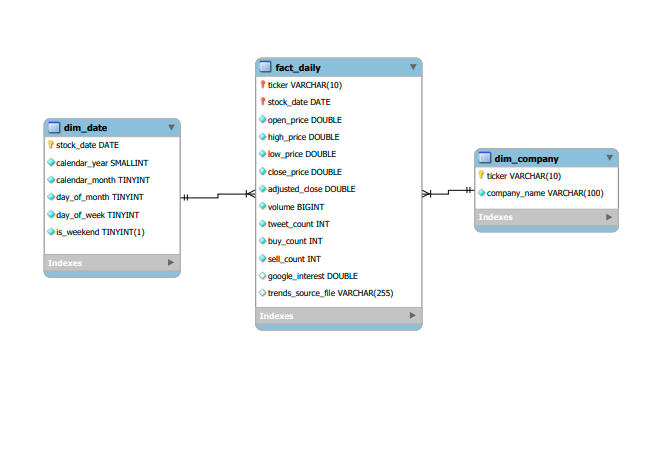

# Stock Attention Data Warehouse

A Python and MySQL project combining stock trading activity, Twitter mentions, and Google search interest to help investment analysts identify unusual patterns and prioritize further research

## Business Problem

Investment analysts monitor market activity and public attention, but these signals often sit in separate sources
This project brings them together to explore when public attention aligns with trading activity, when the signals diverge, and when changes occur in consecutive months

## What I built
- A Python workflow that downloads stock data and loads it into AWS RDS
- Tweet cleaning and SQL functions for counting ticker and buy/sell mentions
- Daily Google Trends processing with coverage checks and quarterly calibration
- A local MySQL star schema containing 3,780 company–trading-day records
- Monthly analysis using LAG, LEAD, moving averages, and percentile rankings

The project covers AAPL, AMZN, GOOGL, MSFT, and TSLA from 2020 - 2022

## Data Workflow

- Stock CSVs -> AWS RDS MySQL  
- Historical tweets -> Python cleaning -> Local MySQL  
- Google Trends CSVs -> Python processing and calibration  
- Python ETL combines these sources into a local MySQL warehouse, which supports analysis across 180 company-months

## Warehouse Design

- The fact table stores one record per company per trading day, combining prices, trading volume, tweet counts, buy/sell word counts, and search interest
- Company and date dimensions connect through the composite key of ticker and stock date
- The date dimension includes every calendar day, while the fact table contains trading days only

## Key Findings and Business Value

The warehouse helps analysts spot mismatches between public attention and trading activity, then decide where to investigate further

### 1. Identify attention that has not translated into trading

**Microsoft, August 2022:** Twitter mentions were about 136% above their previous three-month average, while trading volume was about 25% below its average

**Why it matters:** Increased discussion does not always mean increased market participation. An analyst could review the tweets to distinguish investment related attention from product news or general conversation before treating the activity as a meaningful market signal

### 2. Flag trading increases that online attention may miss

**Microsoft, March 2021:** Trading volume was about 25% above its previous three-month average, while search interest was about 17% below

**Why it matters:** Monitoring search trends alone would not capture this increase in trading activity. The divergence gives an analyst a reason to examine company announcements, market movements, and other potential explanations

### 3. Find patterns worth testing as potential early indicators

**Microsoft, February to March 2020:** Search interest increased 66.16% in February, followed by an 81.71% increase in trading volume in March.

**Why it matters:** The sequence provides a hypothesis to test: can changes in search attention help identify periods of increased trading activity? An analyst would need to check additional periods and daily data
before using it as a predictive signal

This project provides a repeatable screening workflow for investment research.Instead of reviewing stock, Twitter, and search data separately, analysts can compare them in one warehouse and shortlist unusual
company months for closer investigation

## Tools

Python · pandas · NumPy · MySQL · AWS RDS · SQL window functions · Jupyter

## Running the Project

Follow [SETUP.md](SETUP.md) for dependencies, data sources, database configuration, and execution order
The numbered notebooks and SQL files follow the workflow from data preparation through warehouse analysis

## Limitations
- Twitter counts reflect the downloaded dataset, not all platform activity
- Buy/sell word counts measure word occurrences, not validated sentiment
- The findings are exploratory associations and do not establish causation or predictive investment performance
